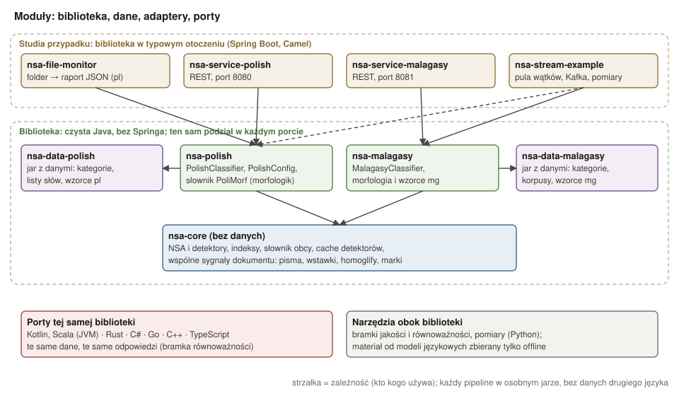
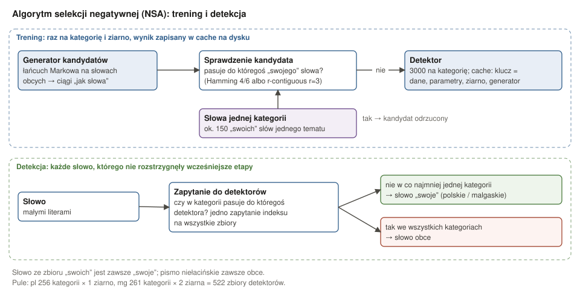
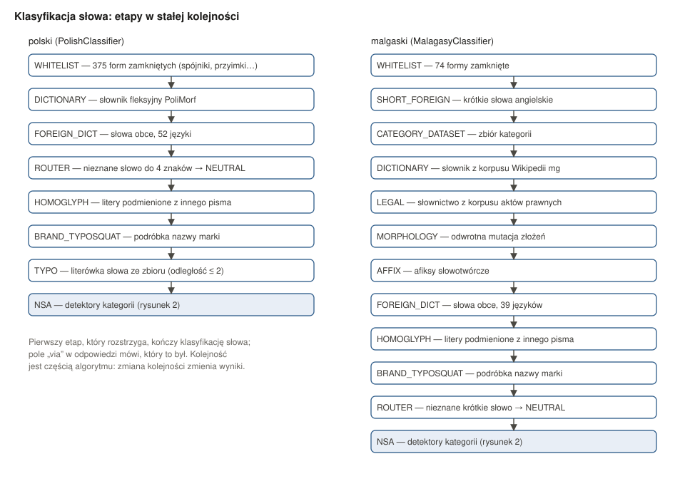
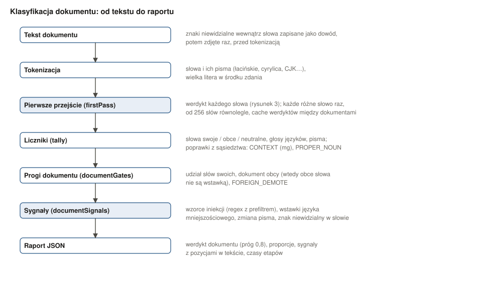
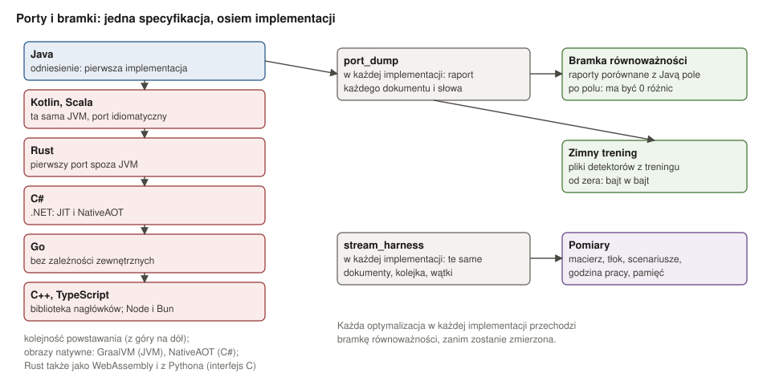
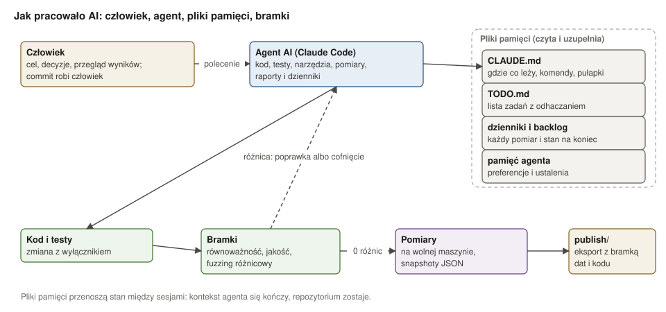

# Architektura i historia projektu

> Co robi biblioteka, z czego się składa, jak powstawała wersja w Javie i jakie decyzje ją ukształtowały. Diagramy są
> w `diagrams/` (SVG). Liczby jakości i historii pochodzą z dzienników projektu, nie z `data/`; wyniki porównania
> implementacji są w `findings/` i `data/`.

## Co robi biblioteka

Biblioteka sprawdza, czy tekst jest napisany w oczekiwanym języku, i wskazuje miejsca, które do niego nie pasują. Wejście
to pojedyncze słowo albo cały dokument. Dla słowa odpowiedź to werdykt (swoje, obce, neutralne, nazwa własna) i nazwa
etapu, który go wydał (pole `via`). Dla dokumentu to raport: udział słów w oczekiwanym języku, werdykt całości i sygnały
z pozycjami w tekście:

- wstawka w innym języku w środku tekstu (np. angielskie polecenie w polskim piśmie),
- zmiana pisma (np. cyrylica w tekście łacińskim),
- homoglify, czyli litery podmienione na podobne z innego pisma,
- podróbki nazw marek (literówka, leetspeak),
- frazy typowe dla prób przejęcia instrukcji modelu językowego (wzorce iniekcji),
- znaki niewidzialne wewnątrz słów.

Są dwa niezależne pipeline'y: polski i malgaski. Zastosowanie, dla którego powstały, to filtr wstępny tekstów, które
trafiają potem do modelu językowego: wykrycie wstawki iniekcji w innym języku albo piśmie, bez używania modelu
językowego w czasie działania.

Dlaczego algorytm selekcji negatywnej (NSA): to metoda ze sztucznych układów odpornościowych, która uczy się wyłącznie
„swoich” słów i nie potrzebuje przykładów ataków. Jest deterministyczna, tania w działaniu i daje się wyjaśnić, bo każdy
werdykt wskazuje etap i regułę. Jej granica jest zarazem wnioskiem projektu: detektor widzi język, nie intencję. Iniekcja
napisana w całości po malgasku w malgaskim tekście nie wygląda na obcą; częściowo łapią ją tylko wzorce fraz.

## Moduły

- **`nsa-core`**: algorytmy bez danych. NSA i detektory, indeksy detektorów, słownik słów obcych, cache detektorów na
  dysku, wspólne elementy sygnałów dokumentu (pisma, wstawki, homoglify, marki). Poprawka wspólnego komponentu działa
  w obu pipeline'ach.
- **`nsa-polish`, `nsa-malagasy`**: biblioteki, czyli klasyfikator i jego konfiguracja. Wartości domyślne konfiguracji
  są wartościami produkcji, a nieznany klucz, zły typ albo wartość spoza zakresu to błąd przy tworzeniu.
- **`nsa-data-polish`, `nsa-data-malagasy`**: dane jako zasoby jarów. Żaden jar nie zawiera danych drugiego języka;
  pilnują tego testy.
- **Adaptery** (studia przypadku): serwisy REST na Spring Boot i Camel, obserwator folderu, przykład strumienia (pula
  wątków, Kafka). Biblioteka nie zależy od żadnego z nich.
- **Porty**: ta sama biblioteka w Kotlinie, Scali, Ruście, C#, Go, C++ i TypeScripcie, na tych samych plikach danych.

## Algorytm: trening i detekcja

- **Zbiór „swoich” słów** to jedna kategoria tematyczna, ok. 150 słów (256 kategorii w polskim, 261 w malgaskim).
  Kategorie wygenerowały offline modele językowe (w malgaskim uzupełnione Wikisłownikiem); po czyszczeniu są danymi
  wejściowymi, nie częścią działania programu.
- **Trening**: generator proponuje kandydata, a kandydat, który nie pasuje do żadnego „swojego” słowa kategorii, zostaje
  detektorem; 3000 detektorów na kategorię. Generatorem jest łańcuch Markowa wyuczony na słowach obcych, więc detektory
  lądują tam, gdzie naprawdę są obce słowa, a nie w losowych ciągach liter.
- **Dopasowanie**: Hamming 4/6 (najwyżej 4 różne pozycje na 6 porównywanych; dokładniejszy) albo r-contiguous r=3
  (wspólny fragment 3 liter; szybszy, domyślny w API).
- **Detekcja**: słowo jest „swoje”, jeśli w co najmniej jednej kategorii nie pasuje do żadnego detektora. Słowo ze
  zbioru „swoich” jest zawsze „swoje” (to niezmiennik algorytmu), słowo w piśmie niełacińskim zawsze obce.
- **Cache**: trening jest kosztowny, więc detektory zapisuje się na dysk. Klucz pliku zawiera wszystko, co wpływa na
  trening (dane, parametry, ziarno, generator), a za trafienie uznaje się tylko kompletny plik.

## Klasyfikacja słowa

Większość słów rozstrzygają słowniki; NSA dostaje tylko to, czego nie zna żaden słownik ani reguła. Kolejność etapów
jest częścią algorytmu. W malgaskim krótkie słowa angielskie są sprawdzane przed zbiorem kategorii, bo zbiór zawiera
wpis `the` (z glosą „tea”) i bez tego etapu angielskie „the” wychodziło jako malgaskie. Homoglify i marki stoją
w malgaskim przed routerem krótkich słów, bo cele takich ataków to słowa 3–4-literowe, które router uznałby za
neutralne.

## Klasyfikacja dokumentu

Oba pipeline'y przechodzą te same cztery kroki: pierwsze przejście (werdykt każdego słowa), liczniki, progi dokumentu,
sygnały. Długi dokument liczy każde różne słowo raz, a słowa rozkłada na wszystkie rdzenie. Kilka etapów działa tylko
w dokumencie, bo potrzebuje sąsiedztwa: kontekst (w malgaskim), nazwy własne, degradacja bardzo krótkich słów w tekście
zdominowanym przez obcy język. Znaki niewidzialne są zdejmowane raz, przed tokenizacją; po tokenizacji słowo z takim
znakiem rozpadłoby się na dwa niewinne kawałki. Ich obecność wewnątrz słowa jest przy tym zapisywana jako osobny sygnał.

## Porty i bramki

Java jest specyfikacją: każdy port musi dać pole po polu te same raporty na wszystkich dokumentach i słowach bramki
(25 850 raportów na pipeline) i te same pliki detektorów z treningu od zera (`findings/01_equivalence.md`). Każda
optymalizacja ma wyłącznik i przechodzi bramkę przed pomiarem. Programy pomiarowe (`port_dump`, `stream_harness`)
istnieją w każdej implementacji w tej samej postaci, żeby mierzyć to samo. Testy jednostkowe w każdym języku, bramki
jakości i cała baza skryptów Pythona: `TESTING.md`.

## Jak powstawała wersja w Javie

Etapy w kolejności, bez kalendarza:

1. **Eksperyment na malgaskim.** Pytanie: czy NSA odróżni słowa malgaskie od obcych? Narzędzie wiersza poleceń
   i przeglądy parametrów (511 konfiguracji na 103 słowach). Wynik: NSA na całym zbiorze ok. 32 tys. słów nasyca się
   i trafia w 59–72%, NSA na jednej kategorii w 93–98%; najlepsze dopasowanie Hamming 4/6 (99,4% w teście kategorii),
   r-contiguous r=3 97,6% przy czasie ok. 1 s zamiast 7,5 s na ranking wszystkich kategorii. Zespoły detektorów
   (ensemble) nie biły pojedynczego Hamminga 4/6.
2. **Serwis i polski.** Serwis REST z pipeline'em polskim (słownik fleksyjny przed NSA, router krótkich słów, a na
   poziomie dokumentu tokenizacja, liczniki i pierwsze sygnały iniekcji), potem malgaskim na tym samym wzorcu. NSA
   stało się ostatnim etapem, nie jedynym.
3. **Jakość.** Bramki jakości: korpusy w obu językach (m.in. konstytucje, Wikipedia, akty prawne, literatura), próbki ataków zamówione od
   wielu modeli językowych i kontrolki fałszywych alarmów. Przy okazji wyszło, że ok. 30% malgaskiego zbioru kategorii to
   był francuski albo angielski dopisany przez model, który go generował; filtr alfabetu podniósł wynik na malgaskiej
   konstytucji z 84,7 do 93,2%. Autorzy próbek są podzieleni na część treningową i kontrolną; malgaskie wzorce iniekcji
   powstają wyłącznie z części treningowej, a każdy wynik mierzy się dwustronnie (tekst we własnym języku ma rosnąć, tekst
   w drugim ma stać).
4. **Dwa programy, potem biblioteka.** Pipeline'y rozdzielono na dwa niezależne programy z danymi w osobnych jarach
   (rdzeń bez danych zmalał z 17,5 MB do 137 KB), a potem na czystą bibliotekę; Spring i Camel zostały studiami
   przypadku.
5. **Wydajność.** Bramka wydajności z kontrolą neutralności (skrót wszystkich wyników musi się zgadzać) i kilkadziesiąt
   kolejnych zmian (`optimizations/00_common.md`, `optimizations/01_java.md`): długi dokument z 70–134 s do 23–120 ms,
   szczyt pamięci zimnego startu z 3–3,6 GB do ok. 0,4–0,46 GB.
6. **Porty.** Najpierw Kotlin i Scala, potem Rust, C#, Go, C++ i TypeScript. Porty i przeglądy przy nich znalazły
   w Javie niedeterminizmy,
   których bramka nie widziała: kolejność kategorii zależną od iteracji mapy, remis marek rozstrzygany inaczej przy
   każdym starcie, ranking zależny od liczby rdzeni i wielkość liter zależną od ustawień regionalnych systemu. Każdą
   poprawiono w Javie i sprawdzono bramką.

Stan jakości przed portami (pomiar projektu): słowa polskiego tekstu uznane przez polski pipeline za polskie 99,91%,
malgaskiego przez malgaski 98,93%; tekst polski przez pipeline malgaski 3,79%, malgaski przez polski 1,62% (odporność:
im mniej, tym lepiej). Wykryte próbki ataków: polski 386 z 409, malgaski 537 z 705.

## Decyzje projektowe

| decyzja | dlaczego | skutek |
|---|---|---|
| żadnego modelu językowego w czasie działania | decyzja właściciela projektu: filtr deterministyczny, bez zewnętrznej usługi, sam nieczuły na iniekcję | modele tylko do materiału offline: kategorie, próbki ataków |
| NSA na kategorię, nie na całym zbiorze | globalny zbiór nasyca przestrzeń detektorów | 256 / 261 małych zbiorów, w malgaskim po dwa ziarna (522 zbiory) |
| NSA jako ostatni etap | słowniki są dokładniejsze i tańsze dla słów znanych | stała kolejność etapów, pole `via` w odpowiedzi |
| dwa dopasowania | Hamming dokładniejszy, r-contiguous szybszy | oba trenowane przy starcie; wybór w żądaniu |
| deterministyczne odpowiedzi | ten sam tekst ma dać ten sam raport na każdej maszynie i w każdym języku | jawna kolejność zamiast iteracji zbiorów, remisy jawnym kluczem, wielkość liter bez ustawień regionalnych |
| fail closed | etap bez danych nie może po cichu przepuszczać | brak lub błąd zasobu włączonego etapu = błąd przy starcie |
| dane w jarach, cache detektorów na dysku | dwa pipeline'y nie mogą się mieszać; trening trwa | osobne jary danych; klucz cache'u zmienia się z danymi |
| biblioteka bez frameworka | to biblioteka, nie serwis | Spring i Camel tylko jako przykłady użycia |
| sufit 500 MB RSS | założony budżet pamięci procesu | Serial GC i sterta ograniczona do 384 MB w Javie; ten sam limit w porównaniu implementacji |
| Java jako specyfikacja portów | jedno źródło prawdy | bramka „0 różnic” zamiast porównywania przybliżonego |
| każda optymalizacja z wyłącznikiem | maszyna nieizolowana, zysk trzeba odróżnić od szumu | A/B na tym samym buildzie, test równoważności nowej i starej ścieżki |

## Jak pracowało AI

Kod portów, narzędzia i pomiary napisał agent AI; człowiek wyznaczał cel, podejmował decyzje i robił commity. Kontekst
agenta kończy się po każdej dłuższej sesji, więc stan żyje w repozytorium: plik operacyjny (gdzie co leży, komendy,
pułapki), lista zadań, dzienniki pomiarów i pamięć agenta z ustaleniami. Każda zmiana przechodzi bramki, a różnica
oznacza poprawkę albo cofnięcie. Pomiary szły osobno, na wolnej maszynie, i trafiały do snapshotów, z których powstał
ten katalog. Przebieg, skala i zmagania: `findings/09_ai_work.md`; opinia AI: `findings/10_ai_verdict.md`; prompty:
`findings/17_prompts.md`.

## Granice

- Detektor widzi język, nie intencję: iniekcja w czystym języku pipeline'u nie jest dla niego obca.
- Malgaski przeplatany francuskim to zmierzona granica: francuskie słowa w malgaskim tekście nie zawsze wyglądają na obce.
- Krótkie słowo, które jest początkiem „swojego” słowa, jest niewykrywalne (cecha dopasowania).
- Wyniki wydajności są względne do jednej maszyny (`MACHINE.md`); równoważność nie zależy od sprzętu.
