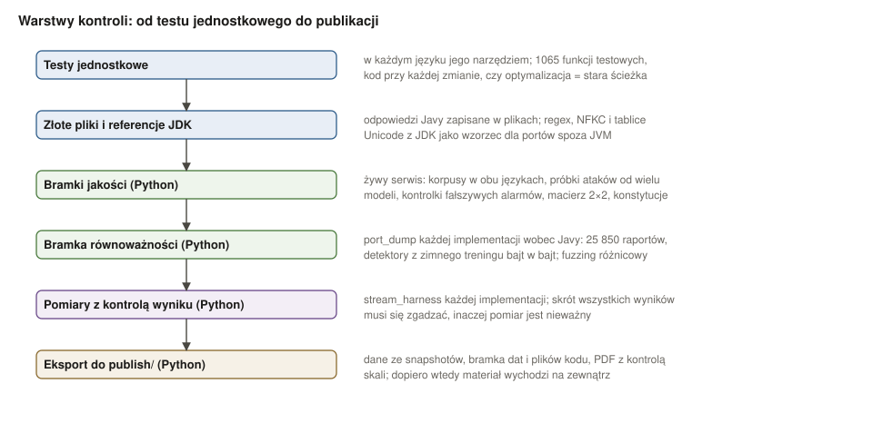

# Testy, bramki i narzędzia

> Co pilnowało jakości i poprawności. Testy jednostkowe są w kodzie każdej implementacji; bramki, pomiary i eksport to
> skrypty Pythona obok bibliotek. Same skrypty zostają w repozytorium projektu, tu jest ich opis. Liczby testów są
> w `data/ai_work.csv` (`unit_tests`) i `data/port_cost.csv` (`test_lines`); stany odniesienia bramek jakości pochodzą
> z dzienników projektu.

## Testy jednostkowe

| implementacja | narzędzie | funkcje testowe | linie testów | czego pilnują przede wszystkim |
|---|---|---|---|---|
| Java | JUnit 5 (Maven) | 527 | 5 600 | niezmienniki NSA, cache detektorów, każdy indeks i filtr = pełne przeszukanie, złote pliki odpowiedzi, konfiguracja serwisów = wartości domyślne biblioteki, rozdział danych pl i mg |
| Kotlin | JUnit 5 | 227 | 3 023 | testy przeniesione z Javy |
| Scala | munit | 133 | 1 923 | testy przeniesione z Javy |
| Rust | `cargo test` | 81 | 2 033 | złote pliki Javy, konfiguracja czytana z klas konfiguracji Javy, regex i NFKC wobec JDK, równoważność optymalizacji |
| C# | xunit | 21 | 547 | regex i NFKC wobec JDK (te same pliki referencyjne co w Ruście), równoważność optymalizacji |
| Go | `go test` | 27 | 1 059 | NFKC i regex wobec JDK, złote pliki pl i mg, konfiguracja z klas Javy |
| C++ | własny program testowy | 32 | 810 | regex i NFKC wobec JDK, test równoważności każdej optymalizacji; build testowy z AddressSanitizer |
| TypeScript | własny program testowy (Node) | 17 | 376 | regex i NFKC wobec JDK, równoważność optymalizacji |

Liczby funkcji nie są porównywalne wprost: w portach spoza JVM jedna funkcja często przechodzi tysiące przypadków (np.
NFKC każdego punktu kodowego wobec JDK). Rodzaje testów, które powtarzają się w każdym języku:

- **Złote pliki.** Skrót odpowiedzi na próbki obu języków, przy obu dopasowaniach i na słowach brzegowych, zapisany
  w pliku. Każda zmiana odpowiedzi kończy test błędem. Zmiana zamierzona: najpierw bramki jakości, potem nowy plik w tym
  samym commicie, a jego diff pokazuje, które wejścia się ruszyły. Porty spoza JVM czytają te same pliki.
- **Nowa ścieżka = stara ścieżka.** Każda optymalizacja ma test porównujący ją z wersją referencyjną: Hamming bez kopii
  z wersją z kopiami (100 000 losowych par), filtry literówek z pełną odległością edycyjną (50 000 par), indeks
  segmentów ze skanem pasma, prefiltr wzorców z samymi wyrażeniami regularnymi na aktach prawnych.
- **Referencje JDK.** Porty spoza JVM odtwarzają z Javy wyrażenia regularne, NFKC, tablice Unicode i generator losowy;
  testy porównują je z wynikami JDK zapisanymi do plików (w Go np. 95 463 dopasowania wzorców = `java.util.regex`).
- **Kontrola statyczna.** Na bajtkodzie Javy, Kotlina i Scali działa zakaz zmiany wielkości liter bez jawnego ustawienia
  regionalnego: pod tureckimi ustawieniami systemu `Ignoruj` zmieniało się w `ıgnoruj` i raport się zmieniał.
- **Kontrola negatywna.** Nowy test raz uruchamia się na celowo zepsutym kodzie i musi się zaczerwienić. Powód: test,
  który się nie skompilował, wyglądał na zielony przez stary raport z poprzedniego przebiegu, a munit pokazywał
  „0 testów” przy udanym budowaniu.
- **Pokrycie** (pomiar w trakcie projektu, JaCoCo i `cargo llvm-cov`): Java 95,1% linii bibliotek z samych testów,
  95,9% razem z bramką równoważności; Rust 88,8% z testów, 76,0% z bramki, 93,5% razem; Kotlin i Scala ok. 66% z testów
  i ok. 95,5% z bramką. Testy i bramka pokrywają różne części kodu, razem prawie całość.

## Bramki jakości

Skrypty Pythona, które wysyłają materiał do działającego serwisu i porównują wynik z poprzednim snapshotem (`--compare`).

| narzędzie | co mierzy | materiał | stan odniesienia |
|---|---|---|---|
| `nsa_quality_check.py` | udział słów uznanych za polskie w polskich tekstach; słowa spoza słownika | trzy korpusy polskich tekstów | 99,36 / 99,77 / 98,25% |
| `malagasy_quality_check.py` | to samo dla malgaskiego, plus tekst polski przez pipeline malgaski i kontrolki (ok. 15 min) | konstytucja i Wikipedia mg, część kontrolna aktów prawnych | 98,9 / 96,9 / 65,8%; tekst polski przez mg 3,8% |
| `sample_recall_gate.py`, `malagasy_sample_recall_gate.py` | ile próbek ataków daje sygnał bezpieczeństwa | próbki od wielu modeli językowych, autorzy podzieleni na część treningową i kontrolną | pl 386 / 409, mg 537 / 705 |
| `foreign_control_fp_check.py`, `malagasy_control_fp_check.py` | fałszywe alarmy na tekstach bez ataku | kontrolki w obcych językach i w języku pipeline'u | pl 0 / 158 obcych kontrolek; mg 125 alarmów na 806 dokumentach |
| `language_matrix.py` | macierz 2×2: każdy pipeline na tekstach obu języków (skuteczność i odporność) | korpusy obu języków | 99,91 / 98,93%; krzyżowo 3,79 / 1,62% |
| `constitution_gate.py` | fałszywe alarmy, wstawki i zmiana pisma na tekstach w 40 językach | 341 konstytucji | pl: 0 / 330 obcych dokumentów z bramkowanym alarmem iniekcji |
| `json_contract_check.py` | kontrakt JSON obu serwisów, poprawne i błędne żądania | — | przy każdej aktualizacji bibliotek |
| `rank_parallelism_check.py` | czy ranking kategorii zależy od liczby wątków | — | 0 różnic |

Zasady, które wyszły z błędów:

- **Mierzyć dwustronnie.** Tekst w języku pipeline'u ma rosnąć, tekst w drugim języku ma stać; wzrost drugiego znaczy,
  że zmiana produkuje śmieci.
- **Listy słów nigdy z materiału bramki.** Buildery czytają tylko część treningową korpusu; lista zbudowana z tekstu, na
  którym mierzy bramka, dawała wynik zawyżony ok. 3×.
- **Kontrola flagą na tym samym buildzie**, nie starym snapshotem: nowe próbki zmieniają mianownik.
- **Nowy sygnał = nowa kolumna w podsumowaniu.** Bramka widzi tylko to, co sumuje: bramka konstytucji nie sumowała
  wstawek języka mniejszościowego i w notatkach stało „0 fałszywych alarmów”, choć 64 z 330 obcych dokumentów miało ten
  sygnał.

## Wycena przed wdrożeniem

- `malagasy_replay.py`, `polish_replay.py`: wycena zmiany offline, na zapamiętanych werdyktach słów albo na raportach
  serwisu, zanim powstanie kod. Dla nowego sygnału obowiązkowa jest ocena z pominięciem jednego autora próbek naraz.
  Granica: wycena per słowo nie widzi etapów dokumentowych (nazwy własne, progi), więc zmianę dotyczącą słów pisanych
  wielką literą potwierdza żywa bramka.
- `malagasy_model_split.py`: zamrożony podział autorów próbek na część treningową i kontrolną; nowy model trafia do
  części według reguły na skrócie nazwy, nie według uznania.
- `mg_builders_check.py`: odtwarzalność całego łańcucha builderów danych malgaskich (zbudować, porównać z repozytorium,
  przywrócić).

## Równoważność implementacji

- `port_gate.py`: raporty każdego dokumentu i słowa z badanej implementacji wobec Javy, pole po polu (25 850 raportów
  na pipeline), a z `--cold` także pliki detektorów z treningu od zera. Ten sam skrypt porównuje starą Javę z nową (każda
  zmiana Javy) i stare JDK z nowym (`findings/01_equivalence.md`).
- `fuzz_gate.py`: fuzzing różnicowy, losowe teksty z ziarnem (mieszane pisma, homoglify, znaki niewidzialne, skrajne
  długości, wstawki iniekcji); ostatnia runda 3000 tekstów, 31 696 raportów na język, 0 różnic.
- `coverage_report.py`: pokrycie kodu testami i bramką (JaCoCo dla JVM, `cargo llvm-cov` dla Rusta).

## Wydajność

Opisane szerzej w `METHODOLOGY.md`; każde narzędzie zapisuje skrót wszystkich wyników, a pomiar z innym skrótem jest
nieważny.

- **Serwis przez HTTP:** `perf_gate.py` (start, pamięć, opóźnienia, czas etapów), `load_gate.py` (kilku klientów naraz),
  `constitution_perf.py` (341 konstytucji jako pomiar).
- **Biblioteka w procesie, każda implementacja:** `stream_gate.py` (przepustowość, pamięć, otwarta pętla, limit
  pamięci, przypięcie do rdzeni), `port_perf_matrix.py` (macierz implementacji w kwadracie łacińskim),
  `load_curve.py` i `cpu_load.py` (tłok na procesorze), `scenarios.py` (scenariusze nazwane), `colocate.py` (kilka
  implementacji na jednym serwerze), `env_ab.py` (A/B tej samej binarki), `endurance_report.py` (godzina pracy).
- **Etapy i profile:** `jfr_stages.py`, `stage_compare.py`, `rust_doc_ab.py`, `gpu_train.py`.
- **Budowanie wariantów:** `go_build.py`, `cpp_build.py`, `rust_pgo.py`, `cpp_pgo.py`, `native_image.py`, `aot_cache.py`.
- **Serie:** skrypty powłoki uruchamiające zestaw pomiarów w ustalonej kolejności, wznawialne po przerwie.

## Koszt, praca AI, eksport

- `session_cost_report.py`, `language_cost_report.py`, `ai_work_report.py`, `prompt_stats.py`: tokeny, czas i przebieg
  pracy z zapisów sesji (`findings/09`, `findings/17`).
- `code_tokens.py`, `code_metrics.py`, `detector_stats.py`: rozmiar i kształt kodu, statystyki detektorów
  (`findings/15`, `findings/16`, `findings/19`).
- `publish_export.py` (tabele ze snapshotów, bramka dat i plików kodu, strona offline), `publish_charts.py`,
  `publish_diagrams.py`, `publish_pdf.py`, `publish_slides.py`: ten katalog.

## Baza skryptów

- **124 skrypty Pythona, ok. 33,5 tys. linii**, do tego 14 skryptów powłoki (serie pomiarów) i 3 skrypty PowerShell
  (pobieranie korpusów).
- Prawie wyłącznie biblioteka standardowa (`argparse`, `json`, `subprocess`, `urllib`, `statistics`,
  `concurrent.futures`); jedyna zależność zewnętrzna to `pypdf` (teksty aktów prawnych z PDF i kontrola gotowego PDF).
  PDF i zrzuty ekranu robi Edge w trybie bez okna.
- Konwencja: opis i przykłady wywołania w nagłówku pliku, wynik jako snapshot JSON z etykietą, porównanie
  z poprzednim snapshotem, wariant kontrolny, który odtwarza znany wynik (narzędzie wyceniające bez niego kilka razy
  pokazało coś, czego nie było).
- Dwa testy samych narzędzi (`unittest`): jawny zbiór list słów obcych (żaden builder nie czyta całego katalogu list)
  i harmonogram otwartej pętli pomiaru (ten sam plik dla każdej implementacji, deterministyczny).
- Python jest tu językiem narzędzi, nie mierzoną implementacją; jedyny pomiar Pythona to wołanie biblioteki Rusta
  przez interfejs C (`findings/08_python_wasm_long_run.md`).
